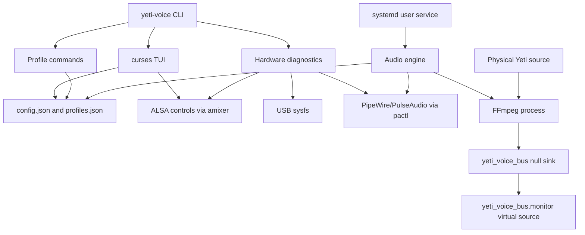

# Architecture

## Scope

Yeti Voice is a single-user Linux audio utility. It discovers one Blue Yeti
Nano source, processes its mono audio through FFmpeg and exposes the result as a
virtual PipeWire/PulseAudio source. It has no server, cloud service, database or
network integration.

## Components

| Component | Responsibility | Evidence |
|---|---|---|
| `yeti-voice` | CLI dispatch for diagnostics, profiles, TUI and daemon | `yeti-voice:main` |
| `yeti_voice/model.py` | Defaults, built-in profiles and atomic JSON persistence | `load_config`, `save_config`, `save_profile` |
| `yeti_voice/dsp.py` | Translation of settings into one FFmpeg filter chain | `build_filter_chain` |
| `yeti_voice/system.py` | USB, ALSA and PipeWire discovery and hardware control | `usb_device`, `set_hardware_percent`, `find_yeti_source` |
| `yeti_voice/daemon.py` | Virtual-source lifecycle, FFmpeg supervision and recovery | `Engine.loop` |
| `yeti_voice/tui.py` | Interactive controls, diagnostics and profile management | `App` |
| `install.sh` | Per-user files, service and optional desktop integration | shell operations in `install.sh` |

## Runtime sequence

1. The systemd user service starts `python -m yeti_voice.daemon`.
2. The engine loads `config.json` or in-memory defaults.
3. It discovers a matching PipeWire/PulseAudio source, or uses
   `YETI_VOICE_SOURCE` when defined.
4. It creates the `yeti_voice_bus` null sink through `pactl`.
5. It starts FFmpeg with the filter chain generated from the active profile.
6. The null sink's monitor becomes the `Yeti Voice (Blue VO!CE)` virtual source.
7. The engine watches the configuration timestamp and process state. A change,
   source replacement or failed FFmpeg process triggers pipeline recreation.
8. Shutdown terminates FFmpeg, restores the previous default source and unloads
   modules created by the current engine instance.

## Persistent and transient state

| State | Default location | Lifetime |
|---|---|---|
| User settings | `~/.config/yeti-voice/config.json` | Persistent |
| Custom profiles | `~/.config/yeti-voice/profiles.json` | Persistent |
| Engine status | `$XDG_RUNTIME_DIR/yeti-voice/status.json` | User session |
| FFmpeg log | `$XDG_RUNTIME_DIR/yeti-voice/ffmpeg.log` | User session |

Configuration and profile writes use a temporary sibling file followed by
`os.replace`, preventing readers from seeing a partially written JSON document.

## Trust boundaries and side effects

- Profile names and values are local user input. Profile names reject control
  characters and are stored as JSON; FFmpeg arguments are passed as an argument
  list rather than through a shell.
- `YETI_VOICE_SOURCE` is forwarded as one FFmpeg input argument. It should only
  be set from a trusted local source name.
- The TUI can change ALSA gain and headphone volume and can select the virtual
  source as the user's default input.
- `install.sh` writes user configuration directories and restarts a user service.
  It should be reviewed before execution.
- No component sends audio or configuration to a network endpoint.

## Failure behavior

- Missing configuration or malformed JSON falls back to defaults.
- Missing devices put the engine into `waiting_device`; discovery retries.
- PipeWire/PulseAudio timeouts and FFmpeg early exit are written to runtime
  status and retried.
- Cleanup is best-effort for source restoration and module unloading.

The test suite mocks hardware mutation. Actual audio routing, device recovery and
DSP quality require hardware validation on the target Linux session.
